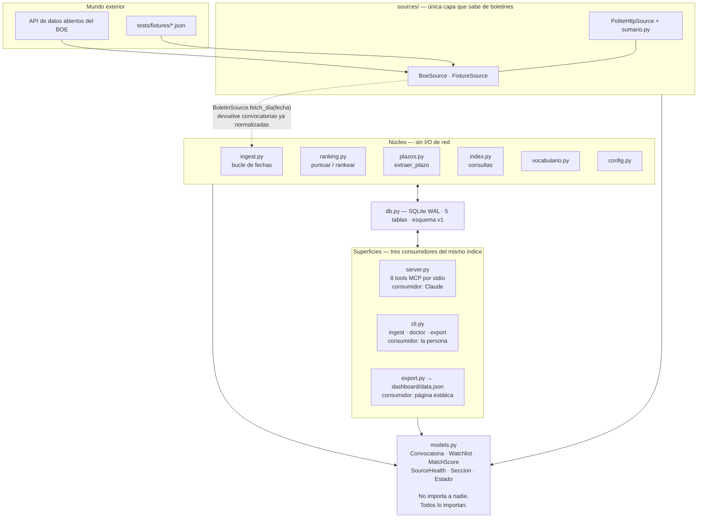
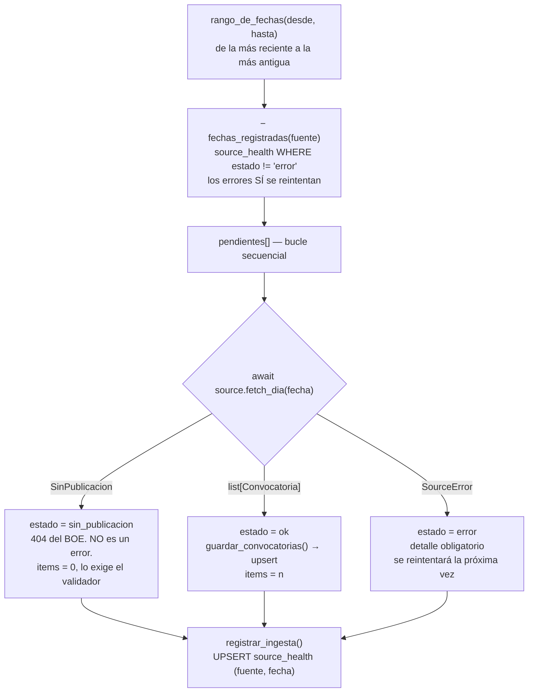
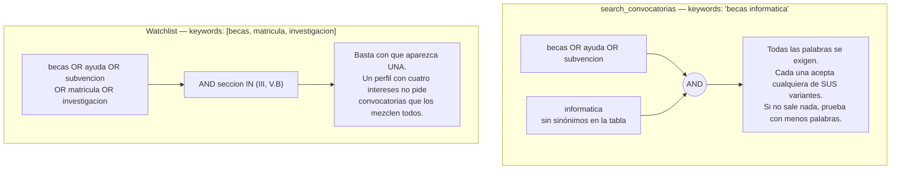
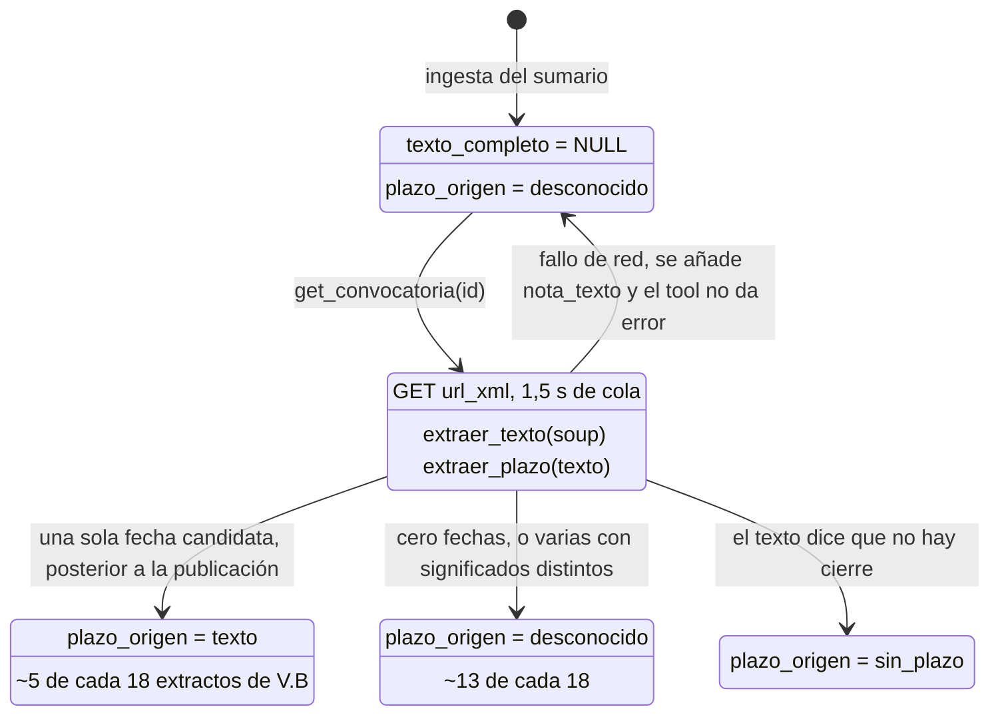
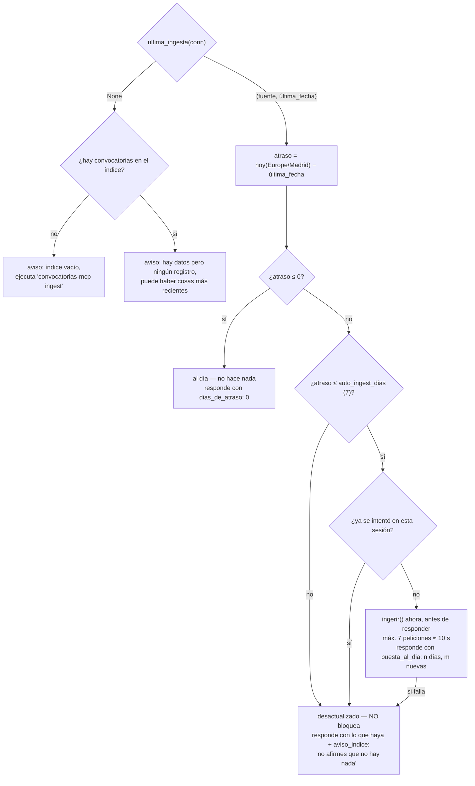
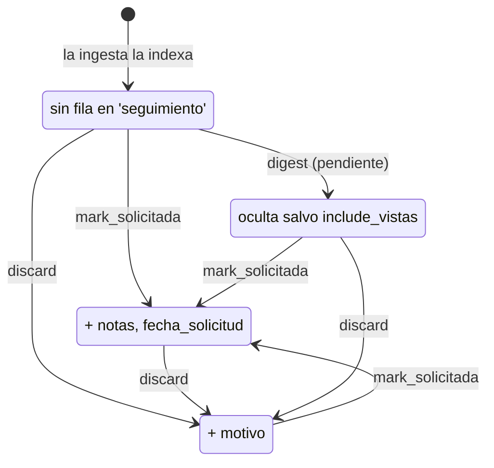

# Arquitectura de convocatorias-mcp

Nota de arquitectura escrita a partir del código, no del README: qué hace cada
pieza, por qué está donde está y qué invariante protege.

El [README](../README.md) cuenta qué es el proyecto y cómo se usa. Este
documento es para quien va a tocar el código.

- [1. La tesis: dos niveles de matching](#1-la-tesis-dos-niveles-de-matching)
- [2. Mapa de módulos y dependencias](#2-mapa-de-módulos-y-dependencias)
- [3. El dominio y sus invariantes](#3-el-dominio-y-sus-invariantes)
- [4. La interfaz de fuente y la cortesía](#4-la-interfaz-de-fuente-y-la-cortesía)
- [5. Ingesta: incremental e idempotente](#5-ingesta-incremental-e-idempotente)
- [6. El índice SQLite](#6-el-índice-sqlite)
- [7. Nivel 1: búsqueda y vocabulario](#7-nivel-1-búsqueda-y-vocabulario)
- [8. El ranking, con aritmética](#8-el-ranking-con-aritmética)
- [9. Nivel 2: texto oficial y plazos](#9-nivel-2-texto-oficial-y-plazos)
- [10. Puesta al día automática](#10-puesta-al-día-automática)
- [11. Seguimiento: la máquina de estados](#11-seguimiento-la-máquina-de-estados)
- [12. Empaquetado `.mcpb`](#12-empaquetado-mcpb)
- [13. Cómo se sostiene](#13-cómo-se-sostiene)
- [14. Límites conocidos](#14-límites-conocidos)

---

## 1. La tesis: dos niveles de matching

Todo el diseño sale de una sola decisión: **qué hace el código y qué hace el
modelo**. El BOE publica unos 270 items al día en prosa administrativa. Hay dos
cosas muy distintas que hacer con eso, y confundirlas es lo que hace malos a la
mayoría de agregadores.

**Nivel 1, en código.** Reducir ~15.000 convocatorias a un puñado de
candidatas. Tiene que ser barato, determinista y repetible: un `LIKE` sobre un
título normalizado y una suma ponderada. Cero llamadas a ningún modelo.

**Nivel 2, en el modelo.** Leer requisitos: renta, edad, unidad familiar,
empadronamiento, baremos de méritos. Eso viene en prosa jurídica con formatos
infinitos y **no se parsea con expresiones regulares**. Es exactamente para lo
que existe MCP.

El corte entre niveles no es cosmético, condiciona el esquema: el scoring *no
puede* mirar el texto completo, porque puntuar con texto obligaría a descargar
15.000 documentos del BOE. De ahí que el texto se descargue bajo demanda, y de
ahí que los plazos estén mayoritariamente vacíos, con todo lo que eso arrastra.

> **Restricción de producto, codificada.** El programa no afirma que cumples los
> requisitos. Esa frase vive en `models.AVISO_NO_ELEGIBILIDAD`, no en el prompt
> de cada tool, y se adjunta a toda respuesta que hable de requisitos. Está en el
> modelo de datos para que no se pueda omitir por descuido al escribir un tool
> nuevo, y hay tests de que ninguna respuesta sale sin él ni sin la cita que
> exige la licencia del BOE.

---

## 2. Mapa de módulos y dependencias

La forma es una tubería clásica con una inversión de dependencia en la entrada:
`fuentes → normalización → índice → ranking → superficies`. Lo importante es la
dirección de las flechas: **nada aguas abajo conoce ningún boletín concreto**, y
`models.py` no importa a nadie.



Las dos aristas que importan son las punteadas y las que apuntan a `models.py`:
las fuentes solo se ven a través de `BoletinSource`, y todo el mundo depende del
modelo de dominio, que no depende de nadie. Añadir el BOCM es crear un fichero,
implementar `fetch_dia()` y añadir una línea al registro `FUENTES`.

| Módulo | Líneas | Responsabilidad |
|---|---:|---|
| `models.py` | 739 | Qué es una convocatoria. Validadores e invariantes. |
| `server.py` | 834 | Los 8 tools MCP y sus descripciones. |
| `cli.py` | 573 | `ingest`, `doctor`, `export` y el entry point. |
| `index.py` | 563 | Lectura y escritura del índice. |
| `sources/base.py` | 511 | La interfaz y la infraestructura de acceso educado. |
| `db.py` | 312 | Esquema, conexión y estado del índice. |
| `ranking.py` | 279 | Afinidad entre convocatoria y watchlist. |
| `export.py` | 262 | JSON del dashboard, solo metadatos. |
| `config.py` | 227 | Variables de entorno y carga de watchlists. |
| `sources/sumario.py` | 181 | Parseo puro del sumario del BOE. |
| `sources/boe.py` | 174 | La fuente real. |
| `ingest.py` | 157 | Bucle de fechas incremental. |
| `plazos.py` | 131 | Extracción conservadora del plazo. |
| `vocabulario.py` | 113 | Sinónimos del lenguaje administrativo. |
| `sources/fixture.py` | 83 | Fuente de desarrollo, sin red. |
| `sources/__init__.py` | 81 | Registro explícito de fuentes. |

---

## 3. El dominio y sus invariantes

`models.py` es Pydantic v2 y es el único sitio donde se define qué es una
convocatoria. Tres reglas lo atraviesan entero, y las tres están puestas como
código y no como convención.

### Invariante 1: nada se inventa

El campo más peligroso del modelo es `plazo_fin`, porque alguien se fiaría de
él. Va siempre emparejado con `plazo_origen`, y un `model_validator` impide que
se contradigan:

```python
if plazo_fin is not None and plazo_origen is DESCONOCIDO:
    raise ValueError("plazo_fin tiene fecha pero no dices de dónde salió")
if plazo_fin is None and plazo_origen is TEXTO:
    raise ValueError("plazo_origen es 'texto' pero no hay plazo_fin")
```

La consecuencia la paga la API: `dias_hasta_plazo()` devuelve `None` en vez de
`0` cuando no hay plazo. Eso obliga a quien llame a decidir qué enseñar, en
lugar de recibir un cero engañoso que acabaría pintado como «vence hoy».

### Invariante 2: esto no decide elegibilidad

`MatchScore` mide afinidad temática. Que una beca de informática puntúe 1,0 no
dice nada sobre si el usuario cumple sus requisitos de renta, expediente o
residencia. Esa lectura es del nivel 2 y la hace el modelo sobre el texto
oficial. El aviso viaja en `AVISO_NO_ELEGIBILIDAD` y la cita de la licencia la
declara la propia fuente (`cita_requerida`), no la plantilla de cada salida.

### Invariante 3: el orden es determinista

El BOE **no publica hora**. El sumario trae `"20261017"` y el XML del documento
trae lo mismo. Por eso `fecha_publicacion` es un `date` y no un `datetime`:
guardar un datetime obligaría a inventar una hora, que es justo lo que el modelo
no hace.

El efecto secundario es que las 270 convocatorias de un día empatan. Sin
desempate explícito, dos consultas idénticas devolverían listas distintas según
lo que decidiera SQLite:

```python
clave_orden = (-fecha.toordinal(), seccion.orden, identificador)

# y el mismo criterio, en SQL:
ORDEN_CANONICO_SQL = "c.fecha_publicacion DESC, c.seccion ASC, c.identificador ASC"
```

La fecha va negada para que un `sorted()` normal ya dé el orden de presentación.
Hay un detalle con mantenimiento: la consulta SQL ordena por el *texto* de la
sección, lo cual funciona porque el orden alfabético de `"II.B"`, `"III"`…
coincide por casualidad con el orden del boletín. Hay un test que comprueba que
ambos órdenes siguen coincidiendo, para que una sección nueva no rompa el
criterio en silencio.

### La trampa de los códigos de sección

El enum `Seccion` tiene dos vocabularios y una traducción entre ellos, porque la
API y las personas no hablan igual: el sumario usa `"2B"` y `"3"`; el usuario
escribe `II.B` y `III` en su YAML. `from_api_code()` traduce desde la API y
`from_text()` acepta las dos formas más las variantes sin puntos, para no
castigar un despiste en un fichero de configuración.

Sobre ese enum cuelga `es_de_interes`, que es conocimiento de dominio puesto en
un solo sitio: **II.B** oposiciones, **III** bases de becas y subvenciones,
**V.A** licitaciones y **V.B** extractos. El resto es normativa, nombramientos y
justicia.

---

## 4. La interfaz de fuente y la cortesía

`BoletinSource` es una ABC con una sola operación obligatoria. El contrato que
se le exige a `fetch_dia()` está en su docstring y es lo que permite que el
resto del sistema no sepa nada de boletines:

- Devuelve las convocatorias de *ese* día, ya normalizadas.
- Si el boletín no publicó, lanza `SinPublicacion`. **No** una lista vacía, que
  significaría «publicó y no había nada».
- Lo que no encuentre queda en `None`. No deduce un plazo que no esté escrito.
- Cualquier otro fallo sale como `SourceError` y nada más; la excepción original
  va en `cause`.
- No descarga textos completos: eso es `fetch_texto()`, bajo demanda.

### Dos excepciones, no una

Que `SinPublicacion` sea una clase aparte de `SourceError` es la decisión con
mejor relación coste/beneficio del módulo. El BOE responde `404` los domingos, y
eso **no es un error**: es información válida. Si se tratara como error, la
ingesta reintentaría esas fechas para siempre y la salud de la fuente aparecería
degradada eternamente.

### La cortesía va en la clase base, no en cada fuente

`PoliteHttpSource` centraliza los cuatro requisitos para que ninguna fuente
futura pueda olvidarse de uno:

| Mecanismo | Implementación | Detalle que importa |
|---|---|---|
| User-Agent | `user_agent()` | Identificado y con URL del repo. No imita ningún navegador: un administrador puede identificarnos y bloquearnos. |
| Rate limiting | `RateLimiter` | 1,5 s por dominio, con estado **de proceso** (`ClassVar`), no de instancia: dos fuentes o un backfill concurrente comparten la cola y no pueden duplicar el ritmo. |
| `robots.txt` | `RobotsPolicy` | Criterio RFC 9309: 4xx permitido, 401/403 prohibido todo, 5xx o red caída prohibido. Caché por proceso. |
| Consentimiento | `Consentimiento` | Cada fuente declara de dónde viene su permiso, y `robots.txt` solo se comprueba en las que se apoyan en él. |

> **Por qué `robots.txt` no gobierna una API.** `robots.txt` se dirige a
> rastreadores que descubren contenido siguiendo enlaces; no es el documento que
> regula a un cliente de una API publicada para terceros. El contraejemplo está
> verificado: `api.adzuna.com/robots.txt` es `Disallow: /`. Aplicar ahí la
> comprobación cumpliría la letra de un documento que no nos va dirigido
> mientras se ignora el contrato que sí lo está. De ahí el enum
> `Consentimiento`: el BOE declara `DATOS_ABIERTOS` y no pasa por la
> comprobación; una fuente de scraping declararía `ROBOTS` y sí pasaría. El rate
> limit, el User-Agent y la caché no cambian en ninguna.

### El parser del sumario, y lo que enseñó la realidad

`sources/sumario.py` es una función pura: recibe el JSON decodificado y devuelve
convocatorias. La comparten la fuente real y la de fixtures, así que el mapeo
está escrito y testeado una sola vez. La estructura nominal es
`data.sumario.diario[].seccion[].departamento[].epigrafe[].item[]`, con tres
irregularidades que solo aparecen con datos reales:

- **Cualquier nivel puede venir como objeto suelto** en vez de lista cuando hay
  un solo elemento. De ahí `_como_lista()`.
- **`epigrafe` puede no existir**: en V.B hay departamentos con `item`
  directamente debajo. Por eso el parser recorre los dos sitios.
- **A veces hay un nivel `texto` de más** entre `seccion` y `departamento`.
  Apareció en los dos domingos de 2026 en que el BOE sí publicó (ediciones
  extraordinarias por los incendios y por controles fronterizos), y resultó que
  también aparecía en los sumarios normales en la sección V.C, donde estaba
  perdiendo un anuncio en silencio. De ahí `_hijos()`.

Lo que cazó ese fallo merece un nombre: es un **canario**.
`BoeSource.fetch_dia()` trata un sumario descargado con cero convocatorias como
`SourceError`, porque el BOE no publica sumarios vacíos: si no sale nada, la
estructura ha cambiado y es mejor saberlo que guardar un día en blanco.

---

## 5. Ingesta: incremental e idempotente

La API devuelve sumarios **por fecha** y no permite buscar. Esa única
restricción es la razón de que exista un índice local, y hace que la ingesta
sea, literalmente, un bucle sobre fechas.



La tabla `source_health` tiene una fila por *(fuente, día)* y es la que hace la
ingesta incremental: lo que no está ahí, falta. Que los tres estados sean
terminales y distintos es lo que permite separar «el boletín no publicó» de «se
cayó la red», y por tanto distinguir una fuente sana de una degradada.

### Idempotencia: dónde está y qué protege

La clave primaria es el identificador oficial (`BOE-A-2026-21635`), que es
estable, así que reingerir una fecha es un `INSERT … ON CONFLICT DO UPDATE` y no
duplica nada. Pero el upsert ingenuo tendría un bug grave, y el código lo evita
explícitamente:

```sql
ON CONFLICT (id) DO UPDATE SET
    titulo         = excluded.titulo,
    ...
    -- El sumario no trae textos: si el nuevo valor es NULL se conserva
    -- el que ya hubiera, para no borrar una descarga previa.
    texto_completo = COALESCE(excluded.texto_completo, texto_completo),
    plazo_fin      = COALESCE(excluded.plazo_fin, plazo_fin),
    plazo_origen   = CASE WHEN excluded.plazo_origen = 'desconocido'
                          THEN plazo_origen ELSE excluded.plazo_origen END
```

Sin esos `COALESCE`, reingerir un día con `--forzar` borraría los textos
descargados y los plazos extraídos, porque el sumario no los trae. Es el tipo de
fallo que no da error: simplemente, un día las cosas dejan de tener plazo.

### Detalles del bucle

- El rango va **de lo más reciente a lo más antiguo**, para que una ingesta
  interrumpida deje el índice con lo útil.
- `on_progress` se llama una vez por día *pedido*, no por día del rango: un
  backfill de 90 días son varios minutos a 1,5 s por petición, y sin eso no se
  vería nada.
- Es secuencial a propósito. Paralelizar no serviría: el `RateLimiter` es por
  dominio y compartido, así que la cola sería la misma.

---

## 6. El índice SQLite

Cinco tablas, esquema versionado (`SCHEMA_VERSION = 1` en la tabla `meta`) y un
`IndexSchemaError` accionable si no cuadra. La conexión activa tres pragmas que
importan:

- `journal_mode = WAL`, para que el export del dashboard lea mientras la ingesta
  escribe.
- `foreign_keys = ON`. En SQLite están apagadas por defecto, y sin ellas los
  `ON DELETE CASCADE` del esquema serían decorativos.
- `synchronous = NORMAL`.

| Tabla | Clave | Quién escribe | Por qué está separada |
|---|---|---|---|
| `convocatorias` | `id` = `fuente:identificador` | la ingesta | El dato oficial. Una vez publicado, no cambia. |
| `seguimiento` | `convocatoria_id` | el usuario, vía MCP | Otro ciclo de vida: la convocatoria no cambia, lo que haces con ella sí. |
| `source_health` | `(fuente, fecha)` | la ingesta | Hace la ingesta incremental y detecta huecos. |
| `convocatoria_watchlists` | `(convocatoria_id, watchlist)` | — | Normalizada para poder filtrar en SQL. Hoy la búsqueda puntúa en vivo y no la usa. |
| `digest_envios` | autoincremental | — | Prevista para el digest. **No guarda el destinatario**: es un dato personal que no hace falta para saber si un digest ya salió. |

El `id` es `fuente:identificador` y no un hash. La diferencia es operativa: un
hash quita la posibilidad de leer un id en un log o en una URL y saber de qué
convocatoria se habla. El prefijo de fuente lo mantiene único cuando entren
boletines autonómicos, y es también la razón de que, si has poblado el índice
con la fuente `fixture`, tengas que borrarlo antes de ingerir el BOE real:
tendrías la misma convocatoria bajo dos ids.

Hay una columna derivada, `titulo_normalizado`, con el título en minúsculas, sin
acentos y sin puntuación. Está materializada porque el filtro de nivel 1 compara
contra ella en cada búsqueda y nadie escribe «informática» con tilde en un
cuadro de búsqueda.

### Qué es un «hueco»

`estado_del_indice()` recorre el rango entre la primera y la última fecha de
`source_health` y llama hueco a toda fecha que no esté registrada. **Los
domingos no se excluyen**, y es deliberado: la ingesta pide todas las fechas y
registra el 404 como «sin publicación», así que un domingo ingerido no es un
hueco y un domingo que falta sí lo es. La alternativa —asumir que los domingos
no cuentan— habría escondido las dos ediciones extraordinarias que sí existieron.

---

## 7. Nivel 1: búsqueda y vocabulario

`index.buscar()` construye un `WHERE` dinámico. La parte interesante es la
lógica booleana de las palabras clave, que **no es la misma en una búsqueda
explícita que en una watchlist**.



`expandir_keywords()` devuelve una lista por palabra precisamente para no perder
esa diferencia: aplanarla en una sola lista convertiría la búsqueda explícita en
un OR.

### El problema del vocabulario administrativo

Este es uno de los hallazgos de verdad del proyecto. Una oposición no se titula
«oposiciones». Se titula *«Resolución de 8 de octubre de 2026, de la
Subsecretaría, por la que se convoca proceso selectivo para ingreso en el
Cuerpo…»*. Buscar `oposiciones` sobre las 2.255 convocatorias de la sección II.B
devolvía **cero**, y era correcto.

Hay dos respuestas, y el orden entre ellas es la decisión de diseño:

1. **La principal está en la descripción del tool.** `search_convocatorias`
   lleva una docstring larga que le explica al modelo qué contiene cada sección
   y cómo traducir la intención del usuario: «quiero oposiciones de informática»
   → `seccion="II.B"` + `keywords="informatica"`. El cliente es un LLM y eso es
   su trabajo, no el de un filtro `LIKE`.
2. **La red de seguridad es una tabla de 15 sinónimos** en `vocabulario.py`,
   ampliable con un `sinonimos.yaml` propio donde cada clave *sustituye* la de
   serie en vez de sumarse, para poder corregir una entrada y no solo añadir.

El módulo lo dice explícitamente: la tabla no debería crecer mucho; si hace
falta algo más elaborado, la respuesta es mejorar la descripción del tool, no
inflar la tabla. En MCP, **las descripciones son interfaz**, no documentación.

---

## 8. El ranking, con aritmética

`ranking.puntuar()` devuelve `MatchScore | None`, y el `None` es la mitad del
diseño: significa **excluida**, que no es lo mismo que puntuada con cero. Si
vigilas II.B y III, una licitación de V.A no es «poco afín»: es que no la has
pedido.

### Los dos filtros duros

1. **Sección no vigilada → `None`.** La sección es una elección explícita, no una
   preferencia.
2. **Watchlist con keywords y ninguna aparece → `None`.** Una watchlist que
   vigila II.B con tres palabras no está pidiendo las 2.255 convocatorias de la
   sección. Es una regla y no un umbral numérico a propósito: un `min_score`
   colocado «justo por encima de solo-sección» funcionaría con los pesos
   actuales y dejaría de funcionar en silencio al cambiarlos.

### La normalización, que es la parte sutil

Los pesos no suman uno y no tienen por qué. El total se divide entre las
dimensiones que **apliquen**, y `departamento` y `ambito` son *extras*: entran
en el denominador solo si han aportado algo.

Ejemplo real, el que devuelve `explain_match` para la watchlist
`empleo-publico-tic` (3 keywords, vigila II.B) sobre una resolución que convoca
proceso selectivo para el Cuerpo de Sistemas y Tecnologías:

| Dimensión | Peso | Ratio | Puntos | ¿Entra en el denominador? |
|---|---:|---:|---:|---|
| `titulo` | 0,55 | 0,3333 | 0,1833 | sí |
| `departamento` | 0,15 | 0,0 | 0,0000 | **no** — extra que no aporta |
| `seccion` | 0,25 | 1,0 | 0,2500 | sí |

```
total = (0,1833 + 0 + 0,2500) / (0,55 + 0,25)
      = 0,4333 / 0,80
      = 0,5416
```

Si `departamento` contara siempre, una convocatoria con la palabra clave en el
título no podría pasar de 0,84 solo porque su departamento no la repite, y eso
no la hace menos afín: es lo normal.

### Una trampa que el código evita

El scoring expande las keywords con **la misma tabla de sinónimos** que el
filtro SQL. Si no lo hiciera, una convocatoria entraría en los resultados porque
su título dice «proceso selectivo» cuando la keyword es «oposiciones», y acto
seguido el ranking la descartaría por no encontrar la palabra. El filtro la
encuentra, el ranking la tira: un bug silencioso de los caros.

### La dimensión muerta

`ambito` tiene peso 0,05 y **hoy no puntúa nunca**: el BOE no publica el campo y
está vacío en las ~15.000 filas. No resta —solo entra si ambos lados lo traen—
pero tampoco suma. Lo mismo pasa con `SearchFilters.ambito`, que existe pero el
tool MCP no expone, con un comentario que explica por qué: un filtro que siempre
devuelve cero solo hace perder llamadas al modelo.

### El margen al ordenar

Hay un detalle fácil de pasar por alto en `server.search_convocatorias`: con
ranking activo se piden a SQL **hasta 8× más candidatas** de las que se van a
devolver, y se recorta después de puntuar. Si no, se ordenaría solo el puñado
más reciente y una convocatoria muy afín de hace dos semanas no llegaría a verse
nunca.

---

## 9. Nivel 2: texto oficial y plazos

`get_convocatoria(id)` es la frontera entre los dos niveles. La primera vez
descarga el XML del documento, extrae el texto legible, intenta sacar el plazo y
lo cachea todo; a partir de ahí es instantáneo. El texto de un BOE publicado no
cambia, así que la caché es permanente, y es la caché que exige el trato educado
con la fuente.



`guardar_texto()` escribe texto, plazo y origen en una sola pasada, con
`COALESCE`: un reparseo sin fecha nunca borra una que ya se conocía.

El extractor es deliberadamente conservador. Los plazos relativos («veinte días
hábiles desde la publicación») *no* se calculan: haría falta el calendario de
festivos nacionales, autonómicos y locales, y equivocarse en un día es
equivocarse. Un plazo incorrecto es peor que no tener plazo.

> **El falso positivo que dio forma a la regla.** El extractor se equivocó una
> vez en desarrollo: cogió el `31 de diciembre de 2028` de la frase *«la beca no
> podrá superar la fecha límite de 31 de diciembre de 2028»*. Era la **duración**
> de la beca, no su plazo de solicitud; el verdadero era relativo y por tanto no
> calculable. Por eso ahora se exige que la misma frase hable de un plazo *y* de
> presentar algo (`solicitud`, `instancia`, `inscripcion`…), se descartan las de
> `alegacion` / `recurso` / `subsanacion`, y hay un test con ese texto exacto.

### Degradación en lugar de error

Si la descarga del texto falla, **el tool no devuelve error**. Devuelve la
convocatoria, su enlace y una `nota_texto` que le dice al modelo literalmente:
«No se pudo descargar el texto oficial… Lee la convocatoria en `{url}` y no
deduzcas sus requisitos». El razonamiento es que la convocatoria y su enlace
siguen siendo útiles, y lo peor que puede pasar es que el modelo resuma
requisitos que no ha leído, así que se le dice explícitamente que no lo haga.

---

## 10. Puesta al día automática

Este servidor lo arranca Claude en segundo plano y puede llevar días sin usarse.
Trabajar con datos viejos sin saberlo es peor que esperar unos segundos, así que
`_poner_al_dia()` corre antes de cada consulta de lectura. Es una máquina de
decisión con cinco salidas y un presupuesto de tiempo.



El presupuesto es lo que decide: siete días son como mucho siete peticiones a
1,5 s y caben en una respuesta; un backfill de semanas no cabe, así que no se
intenta. El `set` de intentos por proceso evita que, con la red caída, el
usuario espere el timeout en *cada* consulta.

Pase lo que pase, toda respuesta lleva `indice_cubre_hasta`, `dias_de_atraso` e
`indice_desactualizado`. El objetivo está escrito en el código: **que el modelo
nunca afirme que no hay convocatorias cuando lo que pasa es que no ha mirado.**
Es el fallo más dañino posible en esta herramienta, porque es indistinguible de
una respuesta correcta.

Un apunte de zona horaria: «hoy» se calcula en `Europe/Madrid`
(`config.hoy_boletin()`), que es cuando publica el BOE. Si no, una ingesta
lanzada de madrugada desde otra zona pediría el día equivocado. Y `tzdata` es
dependencia explícita en Windows, donde `zoneinfo` no trae la base IANA.

---

## 11. Seguimiento: la máquina de estados

Cuatro estados en la tabla `seguimiento`, con `COALESCE(s.estado, 'nueva')` en
cada consulta: una convocatoria sin fila es `nueva`, sin necesidad de escribir
nada en la ingesta.



No hay transiciones prohibidas —el UPSERT es por `convocatoria_id`, así que
cualquier estado sustituye al anterior— pero sí una invariante: `Seguimiento`
valida que solo una convocatoria `descartada` lleve `motivo`. Y
`marcar_seguimiento()` comprueba antes que la convocatoria exista: devuelve
`False` en vez de crear una fila huérfana, para que un id mal escrito se note.

Efecto de cada estado sobre las consultas:

| Consulta | `nueva` | `vista` | `solicitada` | `descartada` |
|---|---|---|---|---|
| `buscar()` | ✓ | solo con `include_vistas` | ✓ | ✗ |
| `convocatorias_que_vencen()` | ✓ | ✓ | ✓ | ✗ |
| `listar_por_estado()` | — | — | `list_solicitudes` | opcional |

---

## 12. Empaquetado `.mcpb`

Claude Desktop ya no lee `claude_desktop_config.json`: instala servidores
locales como extensiones `.mcpb`. Esta parte merece su sección porque los dos
fallos que aparecieron son **silenciosos** y del tipo «funciona en mi máquina»
en su forma más literal.

### Fallo 1: un venv no es relocalizable

El primer bundle empaquetaba un venv y apuntaba el manifest a su
`convocatorias-mcp.exe`. Arrancaba en la máquina que lo construyó y en ninguna
otra, por dos razones que se suman:

- pip genera los console-scripts con un **shebang absoluto embebido** en el
  `.exe`, apuntando al intérprete del venv que los creó. Instalado en otra ruta,
  el `.exe` reenvía igualmente al directorio de build.
- El venv **no contiene el runtime**: ni `Lib/` ni la DLL de Python viven
  dentro; `pyvenv.cfg` apunta a la instalación base de esa máquina.

El efecto combinado es que la extensión instalada ejecutaba el `site-packages`
del directorio de build, no el suyo. Se detectó mirando el **árbol de procesos**,
no los logs, porque nada fallaba.

### Fallo 2: el PATH no lo decides tú

La versión siguiente usaba el Python del sistema y `PYTHONPATH`. Parecía
razonable y fallaba con un error que no dice lo que pasa:

```
ImportError: cannot import name 'ArgsKwargs' from 'pydantic_core._pydantic_core'
```

La causa: **Claude Desktop construye su propio PATH y antepone la instalación de
Python que detecta**, que no es la que gana en el PATH del sistema. Con un 3.14
por delante, los wheels `cp312` del bundle (`lxml`, `pydantic_core`) no cargan.
No es un problema de configuración del usuario: con dos Pythons instalados, cuál
se usa no lo decide ni el usuario ni el manifest.

La única forma de que el ABI case siempre es **llevar el intérprete dentro**:

```bash
pip install --target mcpb/server/lib .          # árbol plano, sin rutas absolutas
unzip python-3.12.10-embed-amd64.zip -d mcpb/server/python
mcpb pack mcpb dist/convocatorias-mcp.mcpb
```

```json
"command": "${__dirname}/server/python/python.exe",
"args": ["-m", "convocatorias_mcp.cli"]
```

El precio es explícito y está asumido: el bundle pasa de 20 a **31 MB** y queda
atado a `win32`. Soportar macOS y Linux es construir un `.mcpb` por sistema, en
CI.

Dos cabos que solo se ven ejecutando:

- `pip install --target` **no procesa los ficheros `.pth`**, y `pywin32` (que
  llega como dependencia de `mcp`) reparte `pywintypes` por `win32/lib`. Esas
  carpetas van en el `python312._pth` del intérprete embebido, que además ignora
  el `PYTHONPATH` del entorno: otra cosa menos de la que depender.
- Las watchlists **no viajan en el bundle**, ni deben: son datos personales. El
  manifest las pide como `user_config` de tipo `file` y las pasa en
  `CONVOCATORIAS_WATCHLISTS_PATH`, así que Claude Desktop genera la casilla al
  instalar.

> **Metodología, no suerte.** El bundle se prueba desempaquetándolo **en otra
> carpeta** y arrancándolo allí con un PATH hostil: Python 3.14 el primero, y
> también sin ningún Python. Probándolo solo donde se construyó y con el PATH del
> desarrollador, ninguno de los dos fallos aparece.

---

## 13. Cómo se sostiene

363 tests en 16 ficheros, CI en 3.11 y 3.12 con `ruff check`,
`ruff format --check` y cobertura. Tres piezas de la suite valen la pena por sí
mismas.

### La red está cortada por debajo de respx

La regla «ningún test toca la red» no se deja a la buena voluntad: un fixture
`autouse` bloquea la **resolución de nombres**, que es lo más abajo que se puede
cortar sin tocar el sistema operativo. No vale cortar en los transportes de
`httpx` ni en `httpcore`, porque `respx` parchea justo esas capas y los dos
cortafuegos se pisarían. Así, un test con `respx` nunca llega al corte, y uno
sin mock falla antes de abrir un socket.

El docstring documenta por qué existe: al poner el BOE como fuente por defecto,
los tests de `ingest` se fueron a la API real y la suite pasó de 7 a 94 segundos.

### El estado de proceso se limpia entre tests

`RateLimiter` y `RobotsPolicy` guardan estado en `ClassVar` a propósito (ver
§4). Eso significa que el orden de ejecución podría influir en los tests, así que
otro fixture `autouse` los resetea. Es el precio correcto: la alternativa
—estado por instancia— rompería la garantía de cortesía en producción.

### `doctor`, porque nadie ve los errores

Este servidor lo lanza Claude Desktop en segundo plano: si algo está mal
configurado, el usuario solo ve que «no funciona». `doctor` es el sitio donde
mirar, y hace algo que pocos diagnósticos hacen: **cuenta cuántas convocatorias
casa cada watchlist contra el índice real** usando `ranking.puntuar` —el mismo
código que la búsqueda, no un SQL paralelo— y distingue si la culpa de que no
case nada es de las keywords o del `min_score`. Una watchlist mal configurada no
da ningún error: callada, se confunde con «no hay nada que te encaje».

Y nunca imprime credenciales ni datos personales, ni parciales: de las claves
dice la longitud, de las watchlists cuenta las keywords sin listarlas. La salida
está pensada para pegarse en un issue.

---

## 14. Límites conocidos

Por orden de impacto real:

1. **Solo hay BOE.** Los boletines autonómicos no están implementados: antes hay
   que comprobar si ofrecen API de datos abiertos, igual que se verificó el BOE.
   Una ayuda de vivienda protegida de la Comunidad de Madrid no aparece en el
   BOE, así que hoy este programa no la encuentra. La interfaz está preparada; el
   trabajo pendiente es de verificación de fuentes, no de arquitectura.
2. **Cobertura de plazos baja.** Dos causas que se suman: el texto solo se
   descarga bajo demanda, y la mayoría de convocatorias expresan el plazo en días
   hábiles relativos. `deadlines_soon` lo dice en su propia respuesta, pero sigue
   siendo el agujero funcional más visible.
3. **`run_digest` no existe.** Y no está registrado a propósito: un tool
   declarado que no funciona es peor que uno que no existe, porque el modelo lo
   intentaría y se llevaría un error.
4. **La tabla `convocatoria_watchlists` está sin usar.** La búsqueda traduce la
   watchlist a `WHERE` y puntúa en vivo, para que editar el YAML surta efecto sin
   reingerir. La tabla está lista para cuando el coste de puntuar en vivo deje de
   compensar.
5. **`.mcpb` solo `win32`, y sin publicar.** Consecuencia directa de empotrar el
   intérprete. Multiplataforma es una matriz en CI.
6. **El despliegue del dashboard tiene una decisión abierta**, anotada en el
   propio workflow: `data.json` se genera desde el índice local, así que hay que
   elegir entre versionarlo, generarlo en CI con una ingesta programada o subirlo
   como artefacto.

> **Lo que mejor ha envejecido.** El repo empezó siendo `jobscout-mcp`, un
> agregador de ofertas de empleo. Al verificar las fuentes una a una, ninguna
> pasó el criterio de consentimiento explícito, y el proyecto se mudó a datos que
> existen precisamente para ser reutilizados. **La arquitectura sobrevivió al
> pivote sin tocarse:** la interfaz de fuente, el `SourceError`, el rate limiting
> y el patrón fuentes → normalización → índice → ranking son los mismos. Solo
> cambió el dominio. Esa es la prueba de que el corte estaba en el sitio
> correcto.

---

*Fuente de los datos que indexa este proyecto: Agencia Estatal Boletín Oficial
del Estado (https://www.boe.es), bajo sus
[condiciones de reutilización](https://www.boe.es/informacion/aviso_legal/index.php#reutilizacion).
Esta herramienta no es un servicio oficial ni está respaldada por el BOE.*
